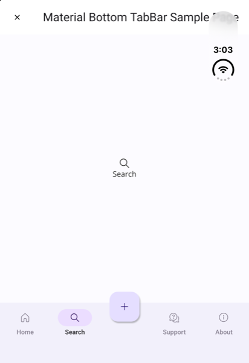
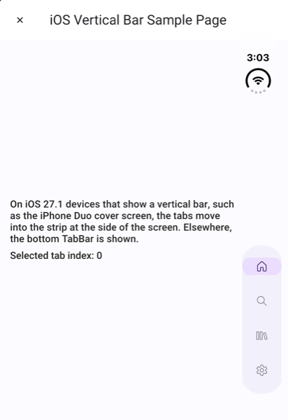
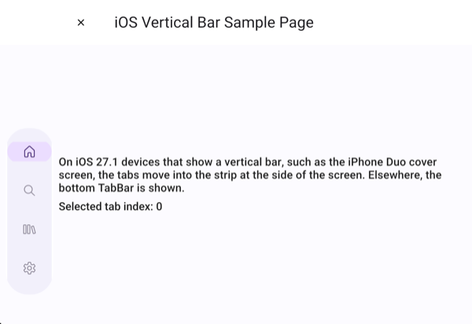

# Display a list of selectable tabs vertically or horizontally

> Packages used below (reference per how-to):
>
> * `Uno.Toolkit.UI` (controls)
> * `Uno.Toolkit.UI.Material` or `Uno.Toolkit.UI.Cupertino` (prebuilt styles, badges, segmented looks)
> * `Uno.Extensions.Navigation` + `Uno.Extensions.Navigation.Toolkit.WinUI` (if you want tab selection to navigate views)
>
> [!IMPORTANT]
> **Always specify a Style on TabBar**
>
> TabBar requires an explicit `Style` attribute to achieve proper Material Design or Cupertino appearance.

## Show a bottom tab bar (icons only)

**When to use:** primary, bottom navigation with icons.

**Packages:** `Uno.Toolkit.UI` + `Uno.Toolkit.UI.Material`

```xml
<Page
    xmlns="http://schemas.microsoft.com/winfx/2006/xaml/presentation"
    xmlns:utu="using:Uno.Toolkit.UI">
    <utu:TabBar SelectedIndex="0" Style="{StaticResource BottomTabBarStyle}">
        <utu:TabBarItem>
            <utu:TabBarItem.Icon><SymbolIcon Symbol="Home"/></utu:TabBarItem.Icon>
        </utu:TabBarItem>
        <utu:TabBarItem>
            <utu:TabBarItem.Icon><SymbolIcon Symbol="Find"/></utu:TabBarItem.Icon>
        </utu:TabBarItem>
        <utu:TabBarItem>
            <utu:TabBarItem.Icon><SymbolIcon Symbol="Help"/></utu:TabBarItem.Icon>
        </utu:TabBarItem>
    </utu:TabBar>
</Page>
```

Notes: `SelectedIndex` sets the starting tab. Use Material or Cupertino theme libraries for built-in styles. ([aka.platform.uno][1])

---

## Switch views when a tab is selected

**Goal:** clicking a tab navigates to a view region.

**Packages:** `Uno.Extensions.Navigation` + `Uno.Extensions.Navigation.Toolkit.WinUI`

**App startup (C#):**

```csharp
var builder = this.CreateBuilder(args)
    .UseNavigation()
    .UseToolkitNavigation(); // enables TabBar to drive regions
```

**XAML:**

```xml
<Page
    xmlns="http://schemas.microsoft.com/winfx/2006/xaml/presentation"
    xmlns:utu="using:Uno.Toolkit.UI"
    xmlns:uen="using:Uno.Extensions.Navigation.UI">
    <Grid>
        <Grid.RowDefinitions>
            <RowDefinition Height="*"/>
            <RowDefinition Height="Auto"/>
        </Grid.RowDefinitions>

        <!-- Where views appear -->
        <ContentControl uen:Region.Name="MainRegion"/>

        <!-- Tabs drive the MainRegion -->
        <utu:TabBar Grid.Row="1" Style="{StaticResource BottomTabBarStyle}">
            <utu:TabBarItem Content="Home"  uen:Navigation.Request="Home"/>
            <utu:TabBarItem Content="Search" uen:Navigation.Request="Search"/>
            <utu:TabBarItem Content="About" uen:Navigation.Request="About"/>
        </utu:TabBar>
    </Grid>
</Page>
```

This wires TabBar selection to a named region for navigation. ([Uno Platform][2])

---

## Show different TabBars for mobile and desktop (responsive)

**Goal:** display a bottom TabBar on mobile, vertical TabBar on desktop.

**Packages:** `Uno.Toolkit.UI` + `Uno.Toolkit.UI.Material`

```xml
<Page
    xmlns="http://schemas.microsoft.com/winfx/2006/xaml/presentation"
    xmlns:utu="using:Uno.Toolkit.UI">
    <Grid>
        <!-- Bottom TabBar for Mobile -->
        <utu:TabBar Style="{StaticResource BottomTabBarStyle}"
                    VerticalAlignment="Bottom"
                    Visibility="{utu:Responsive Normal=Visible, Wide=Collapsed}">
            <utu:TabBarItem Content="Home">
                <utu:TabBarItem.Icon><SymbolIcon Symbol="Home"/></utu:TabBarItem.Icon>
            </utu:TabBarItem>
            <utu:TabBarItem Content="Search">
                <utu:TabBarItem.Icon><SymbolIcon Symbol="Find"/></utu:TabBarItem.Icon>
            </utu:TabBarItem>
        </utu:TabBar>

        <!-- Vertical TabBar for Desktop -->
        <utu:TabBar Style="{StaticResource VerticalTabBarStyle}"
                    HorizontalAlignment="Left"
                    Visibility="{utu:Responsive Normal=Collapsed, Wide=Visible}">
            <utu:TabBarItem Content="Home">
                <utu:TabBarItem.Icon><SymbolIcon Symbol="Home"/></utu:TabBarItem.Icon>
            </utu:TabBarItem>
            <utu:TabBarItem Content="Search">
                <utu:TabBarItem.Icon><SymbolIcon Symbol="Find"/></utu:TabBarItem.Icon>
            </utu:TabBarItem>
        </utu:TabBar>
    </Grid>
</Page>
```

`utu:Responsive` handles all screen size breakpoints automatically and is the modern Uno Toolkit approach. ([Uno Platform][5])

---

## Put the TabBar in the iOS vertical bar

**Goal:** place the tabs where native iOS apps put them on devices with a vertical bar, such as the cover screen of the iPhone Duo.

**Packages:** `Uno.Toolkit.UI` + `Uno.Toolkit.UI.Material`

Starting with iOS 27.1, some devices show a *vertical bar*: a strip along one side of the screen that holds the status bar. On the iPhone Duo cover screen it is 84 pt wide, on the right in portrait and on the left in landscape. Native tab bars move into this strip as an icon-only vertical bar. iOS reports the strip as a left or right safe-area inset. A bottom `TabBar` with `utu:SafeArea` stays clear of it, but the strip is left empty.



The window width doesn't change when the strip appears, so `{utu:Responsive}` can't detect it. Read the iOS `VerticalBarEdge` trait instead, and show an icon-only vertical `TabBar` inside the strip:

```xml
<Page
    xmlns="http://schemas.microsoft.com/winfx/2006/xaml/presentation"
    xmlns:x="http://schemas.microsoft.com/winfx/2006/xaml"
    xmlns:utu="using:Uno.Toolkit.UI">
    <Grid>
        <Grid.RowDefinitions>
            <RowDefinition Height="*"/>
            <RowDefinition Height="Auto"/>
        </Grid.RowDefinitions>

        <!-- Page content -->
        <Grid utu:SafeArea.Insets="Left,Top,Right">
            <!-- ... -->
        </Grid>

        <!-- Default: bottom TabBar -->
        <utu:TabBar x:Name="BottomTabBar"
                    Grid.Row="1"
                    SelectedIndex="0"
                    Style="{StaticResource BottomTabBarStyle}">
            <utu:TabBarItem Content="Home">
                <utu:TabBarItem.Icon><SymbolIcon Symbol="Home"/></utu:TabBarItem.Icon>
            </utu:TabBarItem>
            <utu:TabBarItem Content="Search">
                <utu:TabBarItem.Icon><SymbolIcon Symbol="Find"/></utu:TabBarItem.Icon>
            </utu:TabBarItem>
            <utu:TabBarItem Content="Library">
                <utu:TabBarItem.Icon><SymbolIcon Symbol="Library"/></utu:TabBarItem.Icon>
            </utu:TabBarItem>
            <utu:TabBarItem Content="Settings">
                <utu:TabBarItem.Icon><SymbolIcon Symbol="Setting"/></utu:TabBarItem.Icon>
            </utu:TabBarItem>
        </utu:TabBar>

        <!-- iOS vertical bar: icon-only TabBar inside the strip, placed from code -->
        <Grid x:Name="VerticalBarHost"
              Grid.RowSpan="2"
              VerticalAlignment="Bottom"
              Visibility="Collapsed"
              utu:SafeArea.Insets="Bottom">
            <Border Margin="8"
                    CornerRadius="32"
                    Background="{ThemeResource SurfaceBrush}">
                <!-- The vertical TabBar fills the height it gets, so size it to its items -->
                <utu:TabBar Height="240"
                            MinWidth="0"
                            Padding="0,8"
                            Background="Transparent"
                            SelectedIndex="{Binding SelectedIndex, ElementName=BottomTabBar, Mode=TwoWay}"
                            Style="{StaticResource VerticalTabBarStyle}"
                            utu:SafeArea.Insets="None">
                    <utu:TabBarItem>
                        <utu:TabBarItem.Icon><SymbolIcon Symbol="Home"/></utu:TabBarItem.Icon>
                    </utu:TabBarItem>
                    <utu:TabBarItem>
                        <utu:TabBarItem.Icon><SymbolIcon Symbol="Find"/></utu:TabBarItem.Icon>
                    </utu:TabBarItem>
                    <utu:TabBarItem>
                        <utu:TabBarItem.Icon><SymbolIcon Symbol="Library"/></utu:TabBarItem.Icon>
                    </utu:TabBarItem>
                    <utu:TabBarItem>
                        <utu:TabBarItem.Icon><SymbolIcon Symbol="Setting"/></utu:TabBarItem.Icon>
                    </utu:TabBarItem>
                </utu:TabBar>
            </Border>
        </Grid>
    </Grid>
</Page>
```

```csharp
#if IOS27_1_OR_GREATER
using UIKit;
using Uno.Toolkit.UI;
using Windows.UI.ViewManagement;
#endif

public sealed partial class MainPage : Page
{
    public MainPage()
    {
        this.InitializeComponent();
#if IOS27_1_OR_GREATER
        Loaded += (_, _) =>
        {
            _appView = ApplicationView.GetForCurrentView();
            _appView.VisibleBoundsChanged += OnVisibleBoundsChanged;
            _xamlRoot = XamlRoot;
            if (_xamlRoot is not null)
            {
                _xamlRoot.Changed += OnXamlRootChanged;
            }
            UpdateTabBarPlacement();
        };
        Unloaded += (_, _) =>
        {
            if (_appView is not null)
            {
                _appView.VisibleBoundsChanged -= OnVisibleBoundsChanged;
            }
            if (_xamlRoot is not null)
            {
                _xamlRoot.Changed -= OnXamlRootChanged;
            }
        };
#endif
    }

#if IOS27_1_OR_GREATER
    private ApplicationView? _appView;
    private XamlRoot? _xamlRoot;

    // The vertical bar can appear after launch without a size change.
    private void OnVisibleBoundsChanged(ApplicationView sender, object args) => UpdateTabBarPlacement();

    // On rotation, VisibleBoundsChanged is raised before the window size is updated, so update again once it is.
    private void OnXamlRootChanged(XamlRoot sender, XamlRootChangedEventArgs args) => UpdateTabBarPlacement();

    private void UpdateTabBarPlacement()
    {
        // iOS reports the strip as a left or right safe-area inset.
        var insets = SafeArea.WindowInsets;
        var stripWidth = HasVerticalBar() ? Math.Max(insets.Left, insets.Right) : 0;
        var useStrip = stripWidth > 0;

        BottomTabBar.Visibility = useStrip ? Visibility.Collapsed : Visibility.Visible;
        VerticalBarHost.Visibility = useStrip ? Visibility.Visible : Visibility.Collapsed;
        if (useStrip)
        {
            VerticalBarHost.Width = stripWidth;
            VerticalBarHost.HorizontalAlignment = insets.Left > insets.Right ? HorizontalAlignment.Left : HorizontalAlignment.Right;
        }
    }

    private static bool HasVerticalBar()
    {
        // VerticalBarEdge is iOS-only; IsIOSVersionAtLeast also allows Mac Catalyst, which CA1416 flags.
        if (!OperatingSystem.IsOSPlatformVersionAtLeast("ios", 27, 1))
        {
            return false;
        }

        var scene = UIApplication.SharedApplication.ConnectedScenes.OfType<UIWindowScene>()
            .FirstOrDefault(s => s.ActivationState is UISceneActivationState.ForegroundActive or UISceneActivationState.ForegroundInactive);
        return scene is not null && scene.TraitCollection.VerticalBarEdge != UIVerticalBarEdge.Unspecified;
    }
#endif
}
```

On the iPhone Duo cover screen, the TabBar moves into the strip: on the right in portrait, on the left in landscape.





Notes:

* The vertical bar code only compiles when the app builds against the iOS 27.1 SDK (Xcode 27.1 or later), which defines `IOS27_1_OR_GREATER`. Other platforms and older SDKs keep the bottom TabBar.
* Update on both events. After launch, the strip can appear without the window size changing, which raises only `VisibleBoundsChanged`. On rotation, `VisibleBoundsChanged` is raised before the window size is updated, so `SafeArea.WindowInsets` is only correct once `XamlRoot.Changed` is raised.
* Take the side of the strip from the insets, not from `VerticalBarEdge`: when these events are raised, the trait can still hold the value from before the rotation.
* The strip fits icons but not labels. Give the vertical TabBar a fixed `Height` (about 56 per item plus padding), because it otherwise spreads its items over the full height.
* Binding `SelectedIndex` keeps both TabBars on the same tab when the placement changes.
* Keep other full-width elements out of the strip too. For example, `NavigationBar` styles only inset the top by default; set `utu:SafeArea.Insets="Left,Top,Right"` on it.
* Setting `Visibility` from code replaces a `{utu:Responsive}` value. To combine this with the responsive recipe above, wrap the responsive TabBars in a container and toggle the container's `Visibility` instead.
* The code assumes a left-to-right `FlowDirection`.

---

## Add a selection indicator (underline / slider)

**Goal:** show an indicator above or below the selected item.

**Packages:** `Uno.Toolkit.UI`

```xml
<utu:TabBar SelectedIndex="0">
    <utu:TabBar.SelectionIndicatorContent>
        <Border Height="2" Background="Red" VerticalAlignment="Bottom"/>
    </utu:TabBar.SelectionIndicatorContent>

    <!-- Above content (default). Use Below to not cover content -->
    <utu:TabBar SelectionIndicatorPlacement="Below"/>

    <utu:TabBar.Items>
        <utu:TabBarItem Content="HOME">
            <utu:TabBarItem.Icon><SymbolIcon Symbol="Home"/></utu:TabBarItem.Icon>
        </utu:TabBarItem>
        <utu:TabBarItem Content="SUPPORT">
            <utu:TabBarItem.Icon><FontIcon Glyph="&#xE8F2;"/></utu:TabBarItem.Icon>
        </utu:TabBarItem>
    </utu:TabBar.Items>
</utu:TabBar>
```

You can switch transition behavior with `SelectionIndicatorTransitionMode="Slide|Snap"`. ([aka.platform.uno][1])

---

## Show a small badge (dot) on a tab

**Goal:** indicate a status change without a number.

**Packages:** `Uno.Toolkit.UI` + `Uno.Toolkit.UI.Material`

```xml
<utu:TabBar Style="{StaticResource BottomTabBarStyle}">
    <utu:TabBarItem Content="Favorites"
                    BadgeVisibility="Visible">
        <utu:TabBarItem.Icon><FontIcon Glyph="&#xE113;"/></utu:TabBarItem.Icon>
    </utu:TabBarItem>
</utu:TabBar>
```

> [!IMPORTANT]
> Apply the style to the `TabBar` container (`BottomTabBarStyle` or `VerticalTabBarStyle`), not to individual `TabBarItem` elements. The TabBar's style automatically styles its children.

Badges are supported when using Material `BottomTabBarStyle` and `VerticalTabBarStyle`. ([aka.platform.uno][1])

---

## Show a numbered badge

**Goal:** show counts (e.g., unread messages).

**Packages:** `Uno.Toolkit.UI` + `Uno.Toolkit.UI.Material`

```xml
<utu:TabBar Style="{StaticResource BottomTabBarStyle}">
    <utu:TabBarItem Content="Mail"
                    BadgeVisibility="Visible"
                    BadgeValue="8">
        <utu:TabBarItem.Icon><FontIcon Glyph="&#xE119;"/></utu:TabBarItem.Icon>
    </utu:TabBarItem>
</utu:TabBar>
```

Setting `BadgeValue` switches to the large (numbered) badge. The TabBar's `BottomTabBarStyle` automatically applies the correct styling to child items. ([aka.platform.uno][1])

---

## Add a center FAB tab with a menu

**Goal:** floating action in the tab row with a flyout.

**Packages:** `Uno.Toolkit.UI` + `Uno.Toolkit.UI.Material`

```xml
<utu:TabBar Style="{StaticResource BottomTabBarStyle}">
    <!-- ...left tab(s)... -->
    <utu:TabBarItem Style="{StaticResource BottomFabTabBarItemStyle}">
        <utu:TabBarItem.Flyout>
            <MenuFlyout Placement="Top">
                <MenuFlyoutItem Text="Like">
                    <MenuFlyoutItem.Icon><SymbolIcon Symbol="Like"/></MenuFlyoutItem.Icon>
                </MenuFlyoutItem>
                <MenuFlyoutItem Text="Dislike">
                    <MenuFlyoutItem.Icon><SymbolIcon Symbol="Dislike"/></MenuFlyoutItem.Icon>
                </MenuFlyoutItem>
            </MenuFlyout>
        </utu:TabBarItem.Flyout>
        <utu:TabBarItem.Icon><SymbolIcon Symbol="Add"/></utu:TabBarItem.Icon>
    </utu:TabBarItem>
    <!-- ...right tab(s)... -->
</utu:TabBar>
```

Use `BottomFabTabBarItemStyle` to embed a FAB within the TabBar. ([aka.platform.uno][1])

---

## Make a segmented switch (Cupertino look)

**Goal:** iOS-style segmented control behavior and visuals.

**Packages:** `Uno.Toolkit.UI` + `Uno.Toolkit.UI.Cupertino`

```xml
<utu:TabBar Style="{StaticResource CupertinoSegmentedStyle}">
    <utu:TabBar.Items>
        <utu:TabBarItem Content="ORANGE"/>
        <utu:TabBarItem Content="PURPLE"/>
        <utu:TabBarItem Content="BLUE"/>
    </utu:TabBar.Items>
</utu:TabBar>

<!-- Sliding thumb style -->
<utu:TabBar Style="{StaticResource CupertinoSlidingSegmentedStyle}">
    <utu:TabBar.Items>
        <utu:TabBarItem Content="ORANGE"/>
        <utu:TabBarItem Content="PURPLE"/>
        <utu:TabBarItem Content="BLUE"/>
    </utu:TabBar.Items>
</utu:TabBar>
```

Use `CupertinoSegmentedStyle` or `CupertinoSlidingSegmentedStyle` from the Cupertino theme. ([aka.platform.uno][1])

---

## Disable a tab

**Goal:** make a tab not selectable.

**Packages:** `Uno.Toolkit.UI`

```xml
<utu:TabBarItem Content="Admin" IsSelectable="False">
    <utu:TabBarItem.Icon><SymbolIcon Symbol="Contact"/></utu:TabBarItem.Icon>
</utu:TabBarItem>
```

`IsSelectable="False"` prevents selection; `IsEnabled="False"` also disables interaction. ([aka.platform.uno][1])

---

## Run a command when a tab is clicked

**Goal:** execute an `ICommand` on press (e.g., analytics).

**Packages:** `Uno.Toolkit.UI`

```xml
<utu:TabBarItem Content="Search"
                Command="{Binding TabPressed}"
                CommandParameter="Search">
    <utu:TabBarItem.Icon><SymbolIcon Symbol="Find"/></utu:TabBarItem.Icon>
</utu:TabBarItem>
```

`Command` and `CommandParameter` fire on click/tap. ([aka.platform.uno][1])

---

## Scroll to top when re-tapping the selected tab

**Goal:** common mobile UX—reselecting the active tab scrolls its list to top.

**Packages:** `Uno.Toolkit.UI` (TabBarItem extensions)

```xml
<Grid
    xmlns:utu="using:Uno.Toolkit.UI">
    <utu:TabBar>
        <utu:TabBarItem Content="Feed"
            utu:TabBarItemExtensions.OnClickBehaviors="ScrollToTop"
            utu:TabBarItemExtensions.OnClickBehaviorsTarget="{Binding ElementName=ContentHost}"/>
        <!-- other items -->
    </utu:TabBar>

    <!-- content region containing a ListView/ScrollViewer named ContentHost -->
</Grid>
```

Use `OnClickBehaviors="ScrollToTop"` and point `OnClickBehaviorsTarget` to the content host. ([Uno Platform][3])

---

## Back-navigate when re-tapping the selected tab

**Goal:** reselecting an active tab pops the current page within that tab's stack.

**Packages:** `Uno.Toolkit.UI` (TabBarItem extensions)

```xml
<utu:TabBarItem Content="Home"
    utu:TabBarItemExtensions.OnClickBehaviors="BackNavigation"/>
```

`BackNavigation` finds the first `Frame` with a back stack and navigates back. ([Uno Platform][3])

---

## Listen for selection changes (code-behind)

**Goal:** react when the selected tab changes.

**Packages:** `Uno.Toolkit.UI`

```xml
<utu:TabBar SelectionChanged="OnTabChanged">
    <!-- items -->
</utu:TabBar>
```

```csharp
private void OnTabChanged(utu:TabBar sender, TabBarSelectionChangedEventArgs e)
{
    var oldItem = e.OldItem; // previously selected TabBarItem
    var newItem = e.NewItem; // newly selected TabBarItem
}
```

`SelectionChanged` provides `OldItem` and `NewItem`. ([aka.platform.uno][1])

---

## Place the indicator below content so it doesn't cover text

**Goal:** avoid overlaying the item content.

**Packages:** `Uno.Toolkit.UI`

```xml
<utu:TabBar SelectionIndicatorPlacement="Below">
    <!-- items + indicator template/content -->
</utu:TabBar>
```

"Above" is the default; set `Below` to avoid obscuring content. ([aka.platform.uno][1])

---

## Make a vertical navigation rail

**Goal:** left-side vertical tabs for top-level areas.

**Packages:** `Uno.Toolkit.UI` + `Uno.Toolkit.UI.Material`

```xml
<utu:TabBar Style="{StaticResource VerticalTabBarStyle}">
    <utu:TabBarItem><utu:TabBarItem.Icon><SymbolIcon Symbol="Home"/></utu:TabBarItem.Icon></utu:TabBarItem>
    <utu:TabBarItem><utu:TabBarItem.Icon><SymbolIcon Symbol="Find"/></utu:TabBarItem.Icon></utu:TabBarItem>
    <utu:TabBarItem><utu:TabBarItem.Icon><SymbolIcon Symbol="Help"/></utu:TabBarItem.Icon></utu:TabBarItem>
</utu:TabBar>
```

Material provides `VerticalTabBarStyle`. ([aka.platform.uno][1])

---

## Lightweight style knobs (quick theming)

**Goal:** tweak common sizes/paddings via resource keys.

**Packages:** `Uno.Toolkit.UI.Material`

Examples:
`TopTabBarHeight`, `NavigationTabBarItemIconHeight`, `FabTabBarItemCornerRadius`, badge sizes/margins, etc. Override the keys in your resource dictionaries:

```xml
<Page.Resources>
    <x:Double x:Key="TopTabBarHeight">56</x:Double>
    <Thickness x:Key="NavigationTabBarItemPadding">0,10,0,14</Thickness>
</Page.Resources>
```

See key list in the control docs. ([aka.platform.uno][1])

---

### Related

* Extra TabBar/TabBarItem styles and scenarios (Material & Cupertino). ([aka.platform.uno][1])
* Segmented control looks for TabBar (Cupertino). ([Uno Platform][4])
* Driving navigation with TabBar + Regions. ([Uno Platform][2])

---

### FAQ

**Q: Why does my TabBar look unstyled or basic?**

You likely forgot to set a `Style` attribute on the `TabBar`. TabBar requires an explicit style to get Material Design or Cupertino appearance:

```xml
<!-- Add Style attribute -->
<utu:TabBar Style="{StaticResource BottomTabBarStyle}">
    <!-- items -->
</utu:TabBar>
```

Common styles: `BottomTabBarStyle`, `VerticalTabBarStyle`, `TopTabBarStyle`, `ColoredTopTabBarStyle` (Material), or `CupertinoBottomTabBarStyle`, `CupertinoSegmentedStyle`, `CupertinoSlidingSegmentedStyle` (Cupertino). ([aka.platform.uno][1])

**Q: How do I make TabBar responsive (show different TabBars on mobile vs desktop)?**

Use the `{utu:Responsive}` markup extension on the `Visibility` property. Do NOT use `VisualStateManager` with `AdaptiveTrigger`—that's an outdated pattern:

```xml
<!-- Bottom TabBar visible on mobile (Normal), hidden on desktop (Wide) -->
<utu:TabBar Style="{StaticResource BottomTabBarStyle}"
            Visibility="{utu:Responsive Normal=Visible, Wide=Collapsed}" />

<!-- Vertical TabBar hidden on mobile (Normal), visible on desktop (Wide) -->
<utu:TabBar Style="{StaticResource VerticalTabBarStyle}"
            Visibility="{utu:Responsive Normal=Collapsed, Wide=Visible}" />
```

The `Responsive` extension is the modern Uno Toolkit approach for adaptive layouts. ([Uno Platform][5])

**Q: Why is there an empty strip next to my TabBar on the iPhone Duo?**

On iOS 27.1, the iPhone Duo cover screen shows a vertical bar along one side, and native tab bars move into it. See [Put the TabBar in the iOS vertical bar](#put-the-tabbar-in-the-ios-vertical-bar).

**Q: Which theme packages do I need for the ready-made looks?**

Use `Uno.Toolkit.UI.Material` for Bottom/Top/Vertical/FAB + badges. Use `Uno.Toolkit.UI.Cupertino` for segmented looks. ([aka.platform.uno][1])

**Q: Can I animate the selection indicator?**

Yes—set `SelectionIndicatorTransitionMode="Slide"`, or style `SelectionIndicatorPresenterStyle` for deeper customization. ([aka.platform.uno][1])

**Q: How do I wire this to actual navigation?**

Add `UseToolkitNavigation()` and place a `uen:Region.Name` host (e.g., `ContentControl`) your TabBar items target via `uen:Navigation.Request`. ([Uno Platform][2])

**Q: Are badges supported on Cupertino styles?**

Badges are documented for Material (`BottomTabBarItemStyle`, `VerticalTabBarItemStyle`). ([aka.platform.uno][1])

---

[1]: https://aka.platform.uno/toolkit-doc-tabbar-tabbaritem "TabBar & TabBarItem "
[2]: https://platform.uno/docs/articles/external/uno.extensions/doc/Learn/Tutorials/Navigation/Advanced/HowTo-UseTabBar.html "How-To: Use a TabBar to Switch Views"
[3]: https://platform.uno/docs/articles/external/uno.toolkit.ui/doc/helpers/TabBarItem-extensions.html "TabBarItem Extensions"
[4]: https://platform.uno/docs/articles/external/uno.toolkit.ui/doc/controls/SegmentedControls.html "Segmented Controls"
[5]: https://platform.uno/docs/articles/external/uno.toolkit.ui/doc/helpers/responsive-extension.html "ResponsiveExtension"
